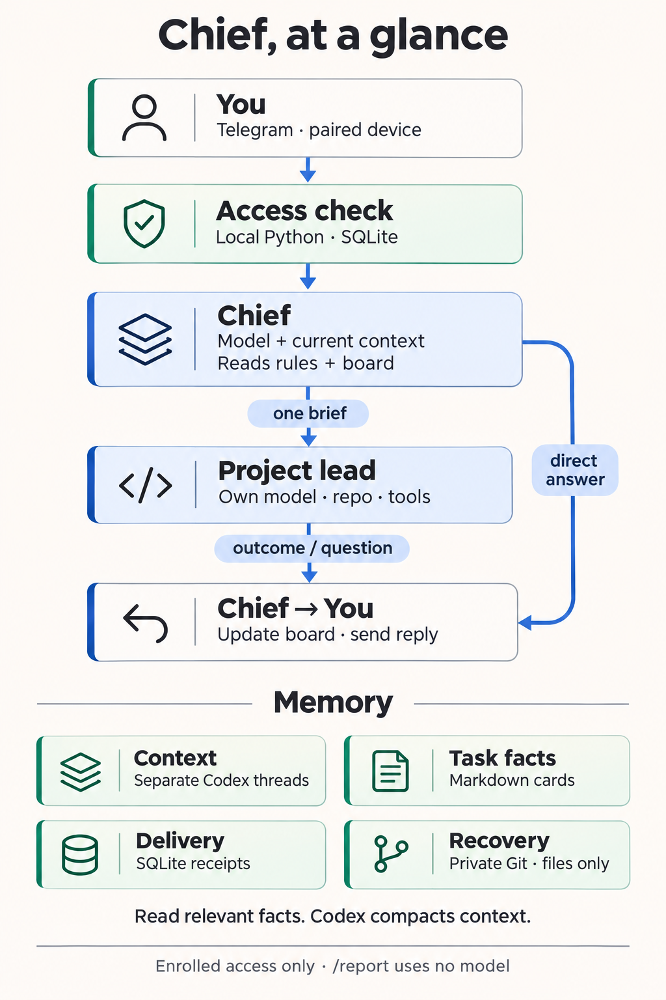

# Chief, at a glance

[Full-size image](overview-v3.png) · [Editable Mermaid](architecture.mmd) · [Resource and memory details](architecture-details.md)

Chief uses the model’s judgment to answer or choose an existing project lead. Small adapters check access and deliver the result. Each lead keeps its own context and tools.

This shows the installed flow, checked November 16, 2026. Public guides do not install the adapters or grant access.
