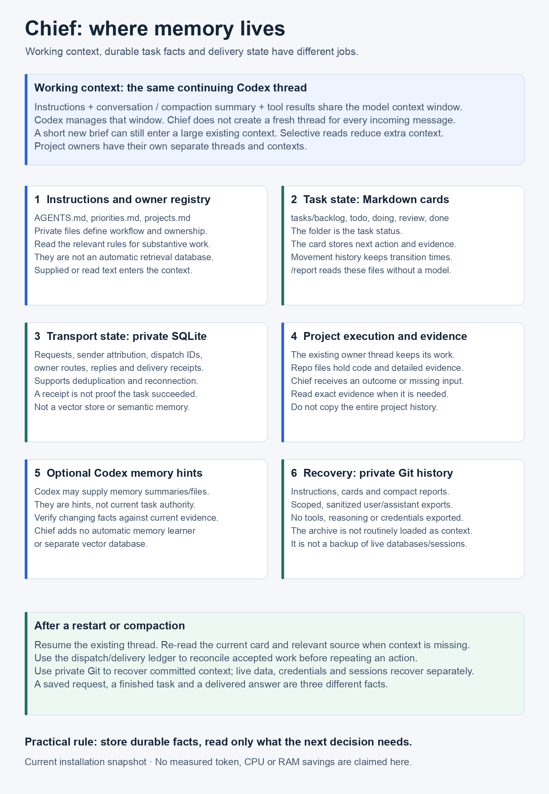

# Chief: request flow, resources and memory

Chief is instructions and a private task board. The model decides how to handle a request and which existing project owner should execute it. Small adapters authenticate senders, preserve requests and deliver replies. There is no model-ranking or planning engine.

These diagrams describe Alfred's installed adapters as checked on November 16, 2026. They show resource types, not measured CPU, RAM, token savings or a fixed number of model calls. The public instruction pack does not install these adapters or grant access.

[Open the resource diagram](architecture.png) · [Editable request-flow Mermaid](architecture.mmd)

| Step | Component and actual work | Resources |
| --- | --- | --- |
| Receive | `telegram_bridge.py`, `alfred_local.py` or `alfred_device_entry.py` verifies the caller and persists the request. | Local Python, network transport, private files and SQLite. No model needed for authentication. |
| Prepare | `alfred_appserver.py` builds attributed input from the message, the relevant replied-to part and supported attachments. | Local CPU/disk; image input consumes model context. The configured local audio decoder uses on-device CPU/GPU; readable transcripts become text context. |
| Decide | The same continuing Chief Codex thread answers directly or chooses the registered owner from relevant instructions/cards. | Currently GPT-6 Astra / Max, its existing context, and requested tools. Chief does not set a task deadline or token budget. |
| Execute | `alfred_projects.py` delivers one brief to the existing owner, which keeps its own model, thread and tools. | Owner context, repository, build/test tools, permitted services and any useful specialists. Native UI requires a real handoff when occupied. |
| Record | Chief receives a completed outcome or necessary missing input, then updates the card and links project evidence. | Chief context, local file I/O, route receipts in SQLite and batched private Git checkpoints. |
| Deliver | The exact-request reply enters the outbox; the collector sends its complete parts and records receipts. | Local Python/SQLite and Telegram API calls; no model needed to transmit saved text. |

The owner's `/report` takes a shorter path: read the saved board and recent completions, render text, then use the same outbox. It makes no model or live-project calls. Idle transport polling also makes no model calls. Only explicitly authorized due tasks can create scheduled work.

[Open the memory diagram](memory.png) · [Editable memory Mermaid](memory.mmd)

The model's working context includes supplied instructions, conversation or compaction summaries, and tool results. Codex manages its context window. Chief resumes or steers the same thread; it does not start an empty context for each message. A short new brief can therefore enter a large existing context. Selective reads reduce additional context; they do not erase previous turns.

Durable task facts live in Markdown cards, whose folder is their status. Each card links evidence and records timestamped moves. SQLite separately stores sender attribution, requests, dispatch IDs, owner outcomes and delivery receipts so reconnection does not blindly repeat actions. It is not a semantic-memory database.

Project owners keep their own contexts and detailed evidence. Optional Codex-supplied memory summaries/files are hints to verify against current facts. Chief adds no separate vector store or automatic memory learner. Private Git preserves instructions, cards, reports and scoped sanitized user/assistant exports; the archive is not routinely injected into requests. Git does not restore live databases, credentials, sessions or media.

After restart or compaction, resume the existing thread, read the current card and necessary evidence, and reconcile accepted actions against the ledger. A saved request, completed task and delivered answer are different facts. Unknown or uncertain delivery is not silently retried.

Backlog holds uncommitted ideas. Todo is committed next work or a scheduled recurrence. Doing means active execution. Review names a human decision. Done records a verified outcome. Testing, deployment and human acceptance remain separate.

For the prompt audit, read [the core](core.md), [onboarding](new.md), then the installation's private instructions, priorities, owner registry, relevant cards and adapter attribution rules. Public guides contain no private records, invitations, credentials or device bindings.
